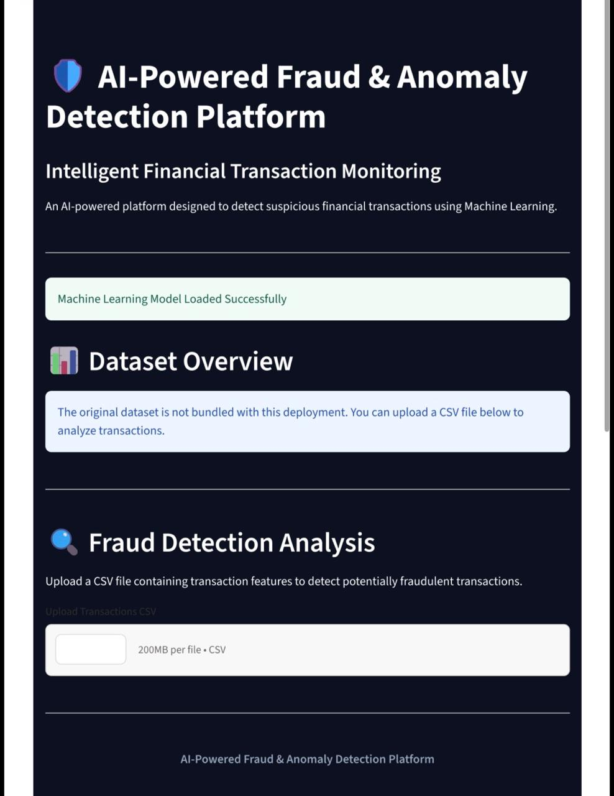

# 🛡️ AI-Powered Fraud & Anomaly Detection Platform

An intelligent financial fraud detection platform that uses Machine Learning to identify suspicious credit card transactions and support fraud monitoring.

The project combines data analysis, machine learning, and an interactive web dashboard to provide an end-to-end fraud detection solution.

## 🎯 Project Objectives

- Detect potentially fraudulent financial transactions.
- Analyze transaction patterns and characteristics.
- Reduce false fraud alerts while identifying suspicious activities.
- Build an interactive application for transaction analysis.

## 📊 Dataset Overview

The project uses the Credit Card Fraud Detection dataset.

| Dataset Information | Value |
|---|---:|
| Total Transactions | 284,807 |
| Normal Transactions | 284,315 |
| Fraudulent Transactions | 492 |
| Fraud Rate | 0.173% |
| Missing Values | 0 |

The dataset contains anonymized transaction features (V1–V28), transaction time, amount, and class label.

## 🔍 Exploratory Data Analysis

The exploratory analysis included:

- Dataset structure and statistical summaries.
- Missing value analysis.
- Fraud and normal transaction distribution.
- Transaction amount analysis.
- Correlation analysis.
- Class imbalance investigation.

## 🤖 Machine Learning

Several approaches were explored and compared, including:

- Logistic Regression
- Random Forest
- Isolation Forest

The final selected model is a tuned Random Forest Classifier.

### Final Model Configuration

| Parameter | Value |
|---|---|
| Model | Random Forest |
| Number of Estimators | 200 |
| Maximum Depth | 12 |
| Minimum Samples per Leaf | 2 |
| Class Weight | Balanced |
| Decision Threshold | 0.4 |

## 📈 Final Model Evaluation

The final model was evaluated using an independent held-out test dataset containing 56,962 transactions.

| Evaluation Metric | Score |
|---|---:|
| Accuracy | 99.94% |
| Precision | 83.67% |
| Recall | 83.67% |
| F1 Score | 83.67% |

### Confusion Matrix

| | Predicted Normal | Predicted Fraud |
|---|---:|---:|
| Actual Normal | 56,848 | 16 |
| Actual Fraud | 16 | 82 |

The model detected 82 out of 98 fraudulent transactions in the independent test set.

## 🖥️ Interactive Web Application

The platform was developed using Streamlit and includes:

- Interactive dashboard.
- Dataset overview and transaction statistics.
- Fraud and normal transaction visualizations.
- CSV file upload.
- Automated fraud predictions.
- Fraud probability estimation.
- Display of detected fraudulent transactions.
- Downloadable prediction results.
- Evaluation metrics when labeled data is provided.

## 🛠️ Technologies Used

- Python
- Pandas
- Scikit-learn
- Streamlit
- Joblib
- PostgreSQL
- Google Colab
- Git
- GitHub

## 📂 Project Structure

```text
Fraud-Intelligence-Platform/
│
├── app.py
├── final_fraud_model.pkl
├── requirements.txt
├── README.md
├── .gitignore
│
└── raw/
    └── creditcard.csv
```

Note: The original dataset and virtual environment are excluded from the GitHub repository.

## 🚀 Run Locally

### 1. Clone the repository

```bash
git clone https://github.com/norannal18-blip/Fraud-Intelligence-Platform.git
```

### 2. Navigate to the project directory

```bash
cd Fraud-Intelligence-Platform
```

### 3. Install dependencies

```bash
pip install -r requirements.txt
```

### 4. Run the application

```bash
streamlit run app.py
```

## 🌐 Deployment

The application is deployed using Streamlit Community Cloud and connected to GitHub.

- Source Code: https://github.com/norannal18-blip/Fraud-Intelligence-Platform
- Live Application: https://fraud-intelligence-platform-vpouwitqhkkcehmgok6vs2.streamlit.app/


## 👩‍💻 Author

**Noran Alghamdi**

Data Science Student  
Umm Al-Qura University

## 📌 Project Purpose

This project demonstrates practical skills in data analysis, machine learning model development, model evaluation, and interactive application deployment for financial fraud detection.
[🚀 Live Demo](https://fraud-intelligence-platform-vpouwitqhkkcehmgok6vs2.streamlit.app/)

[💻 GitHub Repository](https://github.com/norannal18-blip/Fraud-Intelligence-Platform)
## 📸 Application Screenshot

